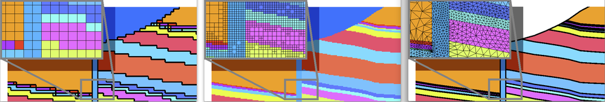

## LaGriT: Los Alamos Grid Toolbox ##

**LANL Software: LA-CC-15-069  No. C15097**

[](https://github.com/lanl/lagrit/releases) [](https://lanl.github.io/LaGriT/pages/licensing.html)

[](https://hub.docker.com/r/ees16/lagrit) <br/>
[](https://lanl.github.io/LaGriT/) <br/>
[](https://lagrit.lanl.gov/) <br/>
[](https://meshing.lanl.gov/) <br/>


> [!NOTE]
> We are currently working on developing Poisson-disk for 3D.


Los Alamos Grid Toolbox (**LaGriT**) is a library of user callable tools that provide mesh generation, mesh optimization and dynamic mesh maintenance in two and three dimensions. LaGriT is used for a variety of geology and geophysics modeling applications including porous flow and transport model construction, finite element modeling of stress/strain in crustal fault systems, seismology, discrete fracture networks, asteroids and hydrothermal systems.

The general capabilities of LaGriT can also be used outside of earth science applications and applied to nearly any system that requires a grid/mesh and initial and boundary conditions, setting of material properties and other model setup functions. It can also be use as a tool to pre- and post-process and analyze vertex and mesh based data.

**PyLaGriT** is a Python interface for LaGriT that allows LaGriT functionality to be accessed interactively and in batch mode from Python.
This allows the meshing capabilities of LaGriT to be combined with the numeric and scientific functionality of Python.
PyLaGriT allows interactive and automated querying of mesh properties, enhanced looping functionality, and user defined error checking based on LaGriT output.

---

### Quick Start

#### Docker Container

The easiest way to get started with LaGriT is through [Docker](https://hub.docker.com/r/ees16/lagrit):

    $ docker pull ees16/lagrit:latest
    $ docker run -it -v $(pwd):/docker_user/work ees16/lagrit:latest

After the container launches, navigate to:

    $ cd bin
    $ ./lagrit


*Docker is no longer available from LANL EES servers as of Sep 1 2025.*

---

### Building LaGriT

#### Dependencies ####

- CMake is used to generate the build system.
- C, C++, and compatible Fortran compilers. MacOS may need command line tools updated.
- OPTIONAL Exodus libraries installed in TPLs, requires bash and wget.

**Note:** There is an issue with Poisson Disk Commands using any Brew installed compilers and Gnu 10-12. Works on Clang 14-15 and Gnu 9.4.

#### Download LaGriT ####

Download the Https repo by running:

```bash
git clone https://github.com/lanl/LaGriT.git
cd LaGriT/
```

Note for developers, you will need the SSH version to enable Git version control to this repository.

[Detailed Instructions for Building LaGriT with cmake and exodus](cmake/README.md)


The simplest way to build LaGriT uses cmake with auto dectection and no options.
Type the following (you can name the build directory anything you want).

```bash
mkdir build/ && cd build/
cmake .. && make
```

The cmake command creates the configuration and build files for lagrit and will look similar to this:
```
-- ==========================================
-- ============Configuring LaGriT============
-- ===================v3.3.3=================
-- Compile LaGriT as a static binary = ON
-- Compile LaGriT with ExodusII = OFF
LaGriT Compiling without ExodusII support.

-- Configuring done
-- Generating done
```

The make command will compile the libraries and build lagrit. Use `make VERBOSE=1` to view compile progress.
The `lagrit` executable is installed in the `build/` directory.


- Type `./lagrit` to make sure the executable is working.
- On the LaGriT command line type `test` which will execute a set of LaGriT commands.
- Type `finish` to exit.

The result will look like:
```
nnodes:              27                                                         
nelements:            8                                                         
xic(1:3):  1.00 1.25 1.50                                                       
imt(1:3):     1    1    1                                                       
epsilonl:   1.9229627E-13                                                       
     Released Mesh Object: test_hex                                             
lagrit test done.                                                               
 
 Enter a command
finish                                                                          
LaGriT successfully completed             
```

### Testing LaGriT

To test LaGriT, start from top and simply run:

```bash
$ python test/runtests.py
```

Test output can be found in the `test/lagrit-tests.log` file.

Additional options are available by running:

```bash
$ python test/runtests.py --help
```


### (Optional) Build LaGriT with ExodusII ###


The only LaGriT command used with ExodusII libs is `dump/exodus` and associated face set and node set commands.
To include these commands you will need Seacas-Exodus (with Fortran support) and its HDF5 and NetCDF libraries.

CMake can fetch, build, and link Exodus for you. This needs network access, git, make, and a Fortran compiler (on macOS install gfortran with `brew install gcc` or MacPorts).

```bash
mkdir build/ && cd build/
cmake .. -DLAGRIT_BUILD_EXODUS=ON -DLAGRIT_FETCH_EXODUS=ON
make
```

During `make`, Seacas is cloned from GitHub and built with HDF5 and NetCDF into `build/_deps/seacas` before LaGriT is compiled. The first build takes several minutes. Later builds in the same directory reuse it.

To use an existing Seacas install instead, point cmake at its install prefix (the directory with `lib/` and `include/`):

```bash
cmake .. -DLAGRIT_BUILD_EXODUS=ON -DEXODUS_ROOT=/path/to/seacas
```

If `EXODUS_ROOT` is not given, cmake looks in `$SEACAS_ROOT`, then `LaGriT/TPLs/seacas`, then `build/_deps/seacas`.

For full and current Exodus Installation instructions, go to:
[Seacas ExodusII](https://github.com/sandialabs/seacas)

[Detailed Instructions for Building LaGriT with cmake and exodus](cmake/README.md)


### CMake Build Options

You can make changes in the CMakeLists.txt file, but your build directory must be empty for globals to take effect. These options are available on the command line and will update cmake global variables.

To use cmake options, use -D as shown in this example:

```bash
mkdir dir_name/ && cd dir_name/
cmake .. -DCMAKE_BUILD_TYPE=Release -DLAGRIT_BUILD_EXODUS=ON -DLAGRIT_FETCH_EXODUS=ON
make
```

- `-D CMAKE_BUILD_TYPE`
  - Sets the build type: `Release` (default, optimized with `-O3`) or `Debug` (`-g`, no optimization and much slower).
- `-D LAGRIT_BUILD_EXODUS=ON`
  - Builds LaGriT with ExodusII (default `OFF`).
- `-D LAGRIT_FETCH_EXODUS=ON`
  - If Exodus is not found, fetches and builds Seacas/Exodus automatically (default `OFF`).
- `-D EXODUS_ROOT=/path/to/seacas`
  - Uses an existing Seacas install prefix containing `lib/` and `include/`.
- `-D SEACAS_GIT_TAG=<tag>`
  - Seacas branch or release tag to fetch (default `master`). Set a release tag for a reproducible build.
- `-D CMAKE_INSTALL_PREFIX`
  - Sets where to install LaGriT when running `make install`. Defaults to `/usr/local/`.
- `-D LAGRIT_BUILD_STATIC`
  - Builds LaGriT as a static binary (default; `ON`) or as a shared library (`.so`, `.dylib`, `.dll`)

### Supporting Documentation ###
---
* [LaGriT Documentation](https://lanl.github.io/LaGriT/)
* [PyLaGriT documentation](https://lanl.github.io/LaGriT/pylagrit/original/index.html)
* [lagrit.lanl.gov: Web Page](http://lagrit.lanl.gov)
* [Contribution Agreement for External Collaborators](CONTRIBUTING.md)
* [Copyright License](LICENSE.md)
* [Code Development with cmake](cmake/README.md)
* [Installation for old LaGriT V2](documentation/INSTALL.md)



##### LaGriT Mesh Images at https://meshing.lanl.gov/proj/screenshots/GRID_GALLERY.html
