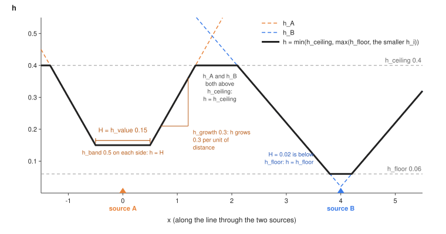
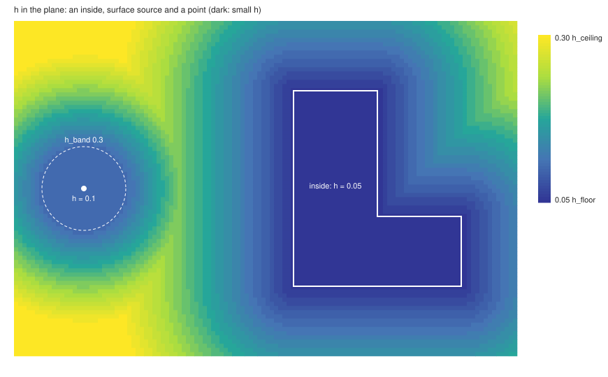
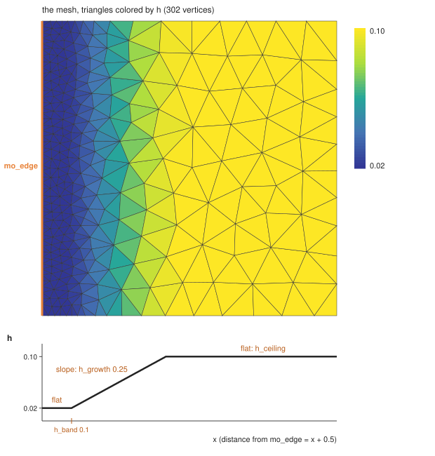

# HFIELD

----------------------

**hfield** builds a named description of the spacing h, the length the
edges of a mesh should have, from a few *sources*: things the mesh
should be fine near, or inside. [createpts / poisson_disk](createpts/createpts_poisson.md)
takes the name (`hfield, hf_name`) where it takes a control file, so a
variable resolution mesh needs no control file. **hfield / eval**
writes h at the vertices of any mesh object, to check a field or to
use it for something else.

## SYNTAX

<pre>
<b>hfield / create</b> / hf_name / <b>h_floor</b>, F / <b>h_ceiling</b>, C [/ <b>h_growth</b>, G]

<b>hfield / add</b> / hf_name / <b>near</b>, mo_src [/ <b>h_value</b>, H | <b>h_attribute</b>, ATT [/ <b>h_factor</b>, A]] [/ <b>h_band</b>, B] [/ <b>h_growth</b>, G]

<b>hfield / add</b> / hf_name / <b>inside</b>, <b>surface</b> / mo_surf [/ <b>h_value</b>, H] [/ <b>h_band</b>, B] [/ <b>h_growth</b>, G]

<b>hfield / list</b> / hf_name

<b>hfield / eval</b> / hf_name / mo / att

<b>hfield / dump</b> / hf_name / file.inp [/ n]

<b>hfield / delete</b> / hf_name
</pre>

Commas and slashes both separate words, so `h_floor, 0.05` is the
keyword and its value. Keywords after the source can come in any order.
A number can be a `define` name. An hfield name has at most 28
characters; names like `hf_dfn` (as `mo_dfn` for mesh objects) keep
them apart from mesh objects.

## THE RULE

For each source i, with d the distance from a point to that source:

```
h_i = H_i + h_growth_i * max(0, d - h_band_i)
h   = min(h_ceiling, max(h_floor, the smallest h_i))
```

- **H_i** is the spacing at the source: **h_value**, or **h_factor**
  times the source's vertex attribute **h_attribute** at its vertex
  nearest the point, or, with neither, **h_floor**.
- **near:** d is the distance to the source: to its triangles and
  lines, or its quads, when it has cells (the exact distance of
  [compute / distance_field / ... / facet](COMPUTE.md)), and to its
  vertices when it has none.
- **inside, surface:** d is 0 inside the surface and the distance to
  it outside, so the whole inside gets H and h grows away from the
  boundary.
- **h_band** keeps h = H out to that distance from the source.
- **h_growth** is how fast h grows with distance (dh/dx, no units).
  [createpts / poisson_disk](createpts/createpts_poisson.md) makes good
  triangles and tets with 0.2 to 0.3.
- Far from every source h is **h_ceiling**. With no source at all, h is
  h_ceiling everywhere.

Every h_i grows by at most its h_growth per unit of distance, so h does
too: the field cannot jump, whatever the sources.

An example along a line: two point sources, mo_a (one vertex at x = 0)
and mo_b (one vertex at x = 4):

```
hfield / create / hf_ex / h_floor, 0.06 / h_ceiling, 0.4 / h_growth, 0.2
hfield / add / hf_ex / near, mo_a / h_value, 0.15 / h_band, 0.5 / h_growth, 0.3
hfield / add / hf_ex / near, mo_b / h_value, 0.02
```



- Near A, h is A's h_value 0.15 out to its h_band 0.5, then grows by
  A's own h_growth 0.3 per unit of distance.
- B has no h_growth of its own, so it grows by create's 0.2. B's
  h_value 0.02 is below h_floor, so near B h is h_floor 0.06.
- Between the sources the smaller h_i wins; where both are above
  h_ceiling, h is h_ceiling 0.4.
- `hfield / eval` on the vertices of that line gives the values drawn
  (the figure is made by figures/make_hfield_figures.py).

| keyword | what | default |
|---|---|---|
| **h_floor** | the smallest h anywhere | required |
| **h_ceiling** | the largest h, and h far from every source | required |
| **h_growth** | dh/dx away from a source; on create, the default for every source; on add, for that source only | 0.2 |
| **h_value** | H, a number | h_floor |
| **h_attribute** | H from a VDOUBLE vertex attribute of the source (for example [edge_lengths_mean](cmo/cmo_addatt.md)) | |
| **h_factor** | multiplies h_attribute | 1.0 |
| **h_band** | the distance out to which h stays H | 0 |

## ACTIONS

**create** makes an empty hfield. **add** adds one source; each add is
one more h_i, and the smallest wins.

**near**, mo_src: any mesh object with vertices: a set of points, a
line mesh, a triangle surface or a DFN (triangles and lines in any
mix), or quads only.

**inside, surface**, mo_surf: in 3D a closed (watertight) surface of
triangles, or of quads only (each cut into 4 triangles at its center,
as `hextotet / 4`, for the distance and for the inside test alike: a
diagonal would make a bent quad a ridge or a valley); in 2D a closed loop of lines, or a mesh
object of vertices only, taken in order as a closed polygon (as for
`createpts / poisson_disk / 2d_polygon`). Closed means every edge is
shared by exactly two cells (every vertex of a loop is on exactly two
lines).

In 3D, inside is the side against the normals of the cells (the
normals by the right-hand rule from the order of each cell's
vertices): the `lt` side, as for [region](REGION.md) and a
[surface](SURFACE.md) / sheet, and found the same way (the k-D tree of
the triangles and the normal of the nearest triangle, edge or vertex).
So for the usual meaning, the normals point out, as they do from
`extract / surfmesh` of a mesh. The orientation is the user's: hfield
uses it as given, and refuses (an ERROR) a surface whose cells do not
all face the same way. With normals pointing in, inside is the
outside of the surface. A hollow shape (a surface inside a surface,
in one mesh object) has its hole outside when the inner surface's
normals point into the hole.

In 2D the lines need not be oriented the same way: hfield orients
them, and decides inside from the winding number with the even-odd
rule.



Above, in 2D: `inside, surface` on an L-shaped polygon (h_value 0.05)
and `near` a point (h_value 0.1, h_band 0.3, h_growth 0.3), with
h_floor 0.05, h_ceiling 0.3 and h_growth 0.2. The whole inside of the
polygon gets 0.05, and h grows away from its sides.

**list** writes the rule in words, one line per source.

**eval** writes h at every vertex of mo into att, a VDOUBLE vertex
attribute (made if it is not there).

**dump** writes h on a lattice of n x n x n vertices (n x n when the
sources are flat in z), n 21 by default, over the bounding box of the
sources' vertices, as an AVS file with the attribute **h_field**, for
ParaView.

**delete** removes the hfield.

The sources are read when h is evaluated, so a source changed after
add is used as it is then.

## ERRORS

Each of these is an ERROR, and nothing is changed:

- h_floor not greater than 0, h_ceiling less than h_floor, h_growth,
  h_value or h_factor not greater than 0, h_band negative;
- create without h_floor or h_ceiling, or of a name that exists;
- an hfield name not made with create;
- a source mesh object that does not exist or has no vertices;
- near: a source with cells other than triangles and lines, or quads
  only;
- h_attribute that is not a VDOUBLE scalar vertex attribute of the
  source; h_value with h_attribute; h_factor without h_attribute;
  h_attribute with inside;
- inside, surface: a surface that is not closed, whose cells do not
  all face the same way (3D), that cannot be oriented (2D), or that
  mixes cell types; a mesh object with no cells and fewer than 3
  vertices;
- eval: att exists and is not a VDOUBLE scalar vertex attribute.

## WITH CREATEPTS / POISSON_DISK

```
createpts / poisson_disk / 3d_box / mo_pts / 0.05 / connect / hfield, hf_dfn
```

`hfield, hf_name` goes where the control file goes; give one or the
other. It works in 2D and 3D, with every h_lookup and face_lattice
option, exactly as a control file that sets the same h. When h_floor
is below h_spacing_scalar, LaGriT writes a WARNING and uses
h_spacing_scalar as the floor.

## EXAMPLES

**A control file and an hfield, side by side.** h is flat (0.02) out
to 0.1 from the left side of a unit square, then grows by 0.25 per
unit of distance, then is flat again (0.1). The square is
unit_square.poly (-0.5 to 0.5; in test/suite/test_poisson_2d); the
source mo_edge is a line of vertices on its left side.

With a control file (before hfield). The deck:

```
read / avs / unit_square.poly / mo_polygon
cmo / create / mo_edge
createpts / line / 101 / / / -0.5 -0.5 0. / -0.5 0.5 0. / 1 1 1
define / H_NEAR / 0.02
define / BAND / 0.1
define / SLOPE / 0.25
define / H_FAR / 0.1
createpts / poisson_disk / 2d_polygon / mo_pts / mo_polygon / 0.02 / &
      connect / flat_slope_flat.mlgi / poisson_seed, 7
dump / avs / old.inp / mo_pts
finish
```

and the control file flat_slope_flat.mlgi, run by createpts on
mo_poi_h_field:

```
# flat_slope_flat.mlgi: h = H_NEAR out to BAND from mo_edge, then
# growing by SLOPE per unit of distance, up to H_FAR
compute / distance_field / mo_poi_h_field / mo_edge / dfield
math / sub / mo_poi_h_field / h_field_att / 1,0,0 / &
       mo_poi_h_field / dfield / BAND
math / floor / mo_poi_h_field / h_field_att / 1,0,0 / &
       mo_poi_h_field / h_field_att / 0.
math / multiply / mo_poi_h_field / h_field_att / 1,0,0 / &
       mo_poi_h_field / h_field_att / SLOPE
math / add / mo_poi_h_field / h_field_att / 1,0,0 / &
       mo_poi_h_field / h_field_att / H_NEAR
math / ceiling / mo_poi_h_field / h_field_att / 1,0,0 / &
       mo_poi_h_field / h_field_att / H_FAR
cmo / DELATT / mo_poi_h_field / dfield
finish
```

With hfield, no control file:

```
read / avs / unit_square.poly / mo_polygon
cmo / create / mo_edge
createpts / line / 101 / / / -0.5 -0.5 0. / -0.5 0.5 0. / 1 1 1
hfield / create / hf_edge / h_floor, 0.02 / h_ceiling, 0.1 / h_growth, 0.25
hfield / add / hf_edge / near, mo_edge / h_value, 0.02 / h_band, 0.1
createpts / poisson_disk / 2d_polygon / mo_pts / mo_polygon / 0.02 / &
      connect / hfield, hf_edge / poisson_seed, 7
dump / avs / new.inp / mo_pts
finish
```

The two decks make the same mesh, vertex for vertex. In the control
file, math / sub and math / floor make max(0, d - BAND): that is
h_band. math / multiply, add and ceiling are h_growth, h_value and
h_ceiling. The floor of the hfield (h_floor 0.02) is the control
file's H_NEAR, the smallest h it makes.



A DFN: tets next to the fractures as long as the fractures' own edges,
growing away from them:

```
cmo / addatt / mo_dfn / edge_lengths_mean / h_dfn
hfield / create / hf_dfn / h_floor, 0.05 / h_ceiling, 1.0 / h_growth, 0.2
hfield / add / hf_dfn / near, mo_dfn / h_attribute, h_dfn / h_factor, 0.74 / h_band, 0.15
hfield / add / hf_dfn / near, mo_well / h_value, 0.02
hfield / add / hf_dfn / inside, surface / mo_lens / h_value, 0.1
hfield / list / hf_dfn
createpts / poisson_disk / 3d_box / mo_pts / 0.05 / connect / hfield, hf_dfn
```

The first line gives each DFN vertex the mean length of its edges; the
first source makes h near the fractures 0.74 times that length, the
same out to 0.15 from them, then growing by 0.2 per unit of distance up
to 1.0. The well gets 0.02, and the whole lens 0.1.

A control file that grows h with the distance from a line, in an
hfield. The control file:

```
cmo / create / mo_dfield
createpts / line / 400 / / / 0.5 0.5 POI_ZMIN / 0.5 0.5 POI_ZMAX / 1 1 1 /
compute / distance_field / mo_poi_h_field / mo_dfield / dfield
math / multiply / mo_poi_h_field / h_field_att / 1,0,0 / mo_poi_h_field / dfield / SLOPE /
math / add / mo_poi_h_field / h_field_att / 1,0,0 / mo_poi_h_field / h_field_att / INTERCEPT /
math / floor / mo_poi_h_field / h_field_att / 1 0 0 / mo_poi_h_field / h_field_att / H_FLOOR
math / ceiling / mo_poi_h_field / h_field_att / 1 0 0 / mo_poi_h_field / h_field_att / H_CEILING
cmo / delete / mo_dfield
```

The same h as an hfield, made once before createpts:

```
cmo / create / mo_axis
createpts / line / 400 / / / 0.5 0.5 0. / 0.5 0.5 1. / 1 1 1 /
hfield / create / hf_axis / h_floor, H_FLOOR / h_ceiling, H_CEILING / h_growth, SLOPE
hfield / add / hf_axis / near, mo_axis / h_value, INTERCEPT
createpts / poisson_disk / 3d_box / mo_pts / H_FLOOR / connect / hfield, hf_axis
```

To look at a field before meshing:

```
hfield / dump / hf_dfn / hf_dfn.inp / 41
```

A field the rule cannot express still needs a control file.

Test: test/suite/test_hfield (the rule checked at query vertices, and
the same mesh from a control file and from an hfield).
