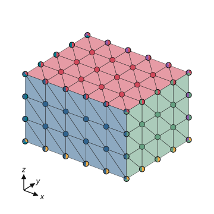
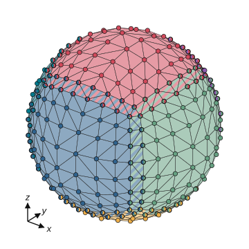
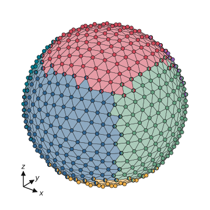
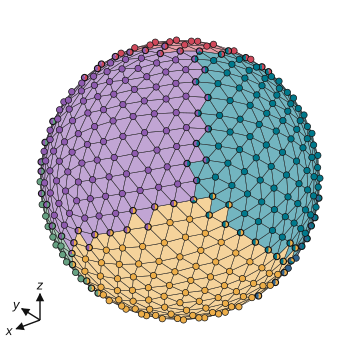
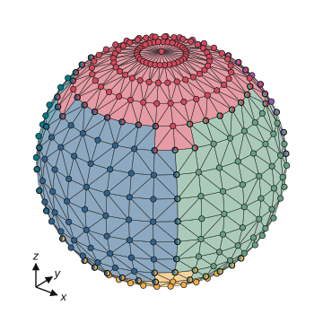
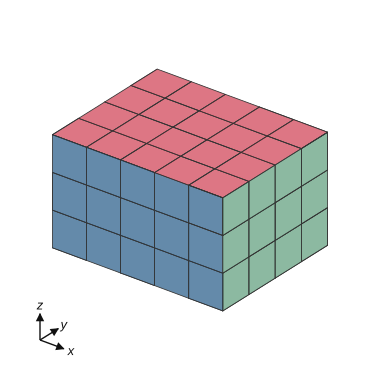

# Outside zones: how top, bottom, left_w, right_e, front_s and back_n are chosen

**`dump/fehm`** and **`dump/zone_outside`** write the vertices on the
outside of a mesh in six zone lists, in `root_outside.zone`, and each
one's outside area vector in `root_outside_vor.area` (see
[DUMP3](DUMP3.md)). The names come from the sides of a box aligned with
the axes:

| zone | number | side | outward direction |
|---|---|---|---|
| top | 1 | top | +z (0, 0, 1) |
| bottom | 2 | bottom | -z (0, 0, -1) |
| left_w | 3 | left, west | -x (-1, 0, 0) |
| front_s | 4 | front, south | -y (0, -1, 0) |
| right_e | 5 | right, east | +x (1, 0, 0) |
| back_n | 6 | back, north | +y (0, 1, 0) |

The same names are used for a mesh of any shape. This page explains how
they are assigned in general, with pictures of three meshes of a sphere
and two of a box.

## The rule

**Each outside face goes to the side its outward normal points to
most.** The code (mask_icr, assign_quadrant_id) tests the normal of
every outside triangle (tets) or edge (triangles) against six planes
through the origin at 45 degrees to the axes: x = y, x = -y, x = z,
x = -z, y = z and y = -z. These planes cut the sphere of directions
into six regions, one around each axis direction, like the six faces of
a cube seen from its center. A normal inside the region around +z goes
to top, and so on. That is the same as: **the side of the normal's
largest component, with its sign.**

- **Ties.** A normal exactly on one of the six planes (two components
  equal in size and largest) is a tie and goes to both sides; a normal
  along a diagonal of the cube (all three equal) goes to all three.
  "Exactly" is within LaGriT's epsilon.
- **Vertices.** A vertex is listed in the zone of every side any of its
  outside faces goes to. So a vertex is in one zone, or in two or three
  where faces of different sides meet.
- **Areas.** The vector in `root_outside_vor.area` is the vertex's whole
  outside area (the sum over its outside faces of each face's share,
  times its unit normal). A vertex listed in two or three zones has the
  same vector in each of them, so a zone's sum of one component counts
  only that component of those vectors: for a box, the x components of
  the left_w vectors add up to the area of the left side.

In the pictures below, each outside face is colored by its side
(striped in two colors for a tie), and each outside vertex is a dot
split into one wedge per zone it is listed in, as LaGriT wrote them.
The small axes in the lower left give the view.

<span style="color:#d1495b">&#9632;</span> top (+z) &nbsp;
<span style="color:#edae49">&#9632;</span> bottom (-z) &nbsp;
<span style="color:#00798c">&#9632;</span> left_w (-x) &nbsp;
<span style="color:#66a182">&#9632;</span> right_e (+x) &nbsp;
<span style="color:#30638e">&#9632;</span> front_s (-y) &nbsp;
<span style="color:#8f5bb0">&#9632;</span> back_n (+y)

## A box



A tet mesh of a 1 x 0.8 x 0.6 box (createpts / xyz, 6 x 5 x 4
vertices, connect). Every face of the box is flat and points exactly
along an axis, so there are no ties. A vertex on an edge of the box has
faces on two sides and is in two zones; a corner is in three (8 of the
96 outside vertices; 36 are in two zones).

## Three meshes of a sphere

The meshes are unit spheres of 6 shells, connected into tets (decks at
the end of the page). Seen from +x, -y, +z, so the top, right_e and
front_s regions face the viewer.



**Projected cube** (createpts / sphere / 1; 1920 vertices, 10624 tets,
384 on the outside). The triangles that span the cube's edges have
normals exactly halfway between two sides: ties (striped), so they count
for both, and their vertices are in two zones (144 vertices); near the
cube's corners vertices are in three (24). The six zones are equal
(96 each).



**Icosahedron** (createpts / sphere / 2; 3211 vertices, 16640 tets, 642
on the outside). No ties. The zone boundaries are jagged lines of
triangles; the vertices on them are in two zones (116), in three where
three regions meet (8). The zones differ a little in size (126 to 133
vertices) because the icosahedron is not aligned with the axes. From the
other side (-x, +y, -z: bottom, left_w, back_n):





**r, theta, phi** (createpts / rtp / 6 17 33; 2411 vertices, 12651
tets, 482 on the outside). No ties. The vertices crowd at the poles, so
top and bottom hold 141 vertices each and the four other sides 77.

## A conforming Voronoi box (dump / fehm ... / exclude)



The same box as a conforming Voronoi mesh: generators at the centers of
a 5 x 4 x 3 grid of cubes, and their mirror images across the six sides
(the ghosts, material 2). With
[dump / fehm / ... / exclude, 2](../DUMP2.md#fehm) no vertex lies on the
box: the outside is made of the faces the cells share with the ghosts.
Each such face goes to a side by the same rule (here every face points
exactly along an axis). A cell with faces on two sides (along an edge
of the box, 24 cells) or three (a corner, 8 cells) is listed in each of
those zones, but **in each zone it carries only its faces on that
side**, so every side's vectors add up to the side's area: 0.8 for top
and bottom, 0.48 for left_w and right_e, 0.6 for front_s and back_n.

## The decks

```
* projected cube (createpts / sphere / 2 for the icosahedron)
cmo / create / mo / / / tet
createpts / sphere / 1 / 6 / 384 / 1.0,0.0 / 0.,0.,0. / 1,0,0.0
cmo / setatt / mo / imt / 1 0 0 / 1
filterkd / 1 0 0
rmpoint / compress
cmo / setatt / mo / itp / 1 0 0 / 0
connect
resetpts / itp
dump / fehm / cube / mo
```

```
* r, theta, phi: in place of the createpts / sphere line above
createpts / rtp / 6 17 33 / 0. 0. 0. / 1. 180. 360. / 1 1 1
```

```
* the conforming Voronoi box
cmo / create / mo / / / tet
createpts / xyz / 7 6 5 / -0.1 -0.1 -0.1 / 1.1 0.9 0.7 / 1 1 1
cmo / setatt / mo / imt / 1 0 0 / 1
cmo / setatt / mo / itp / 1 0 0 / 0
connect
resetpts / itp
pset / pg1 / attribute / xic / 1 0 0 / lt 0.
pset / pg2 / attribute / xic / 1 0 0 / gt 1.
pset / pg3 / attribute / yic / 1 0 0 / lt 0.
pset / pg4 / attribute / yic / 1 0 0 / gt 0.8
pset / pg5 / attribute / zic / 1 0 0 / lt 0.
pset / pg6 / attribute / zic / 1 0 0 / gt 0.6
pset / pg / union / pg1 pg2 pg3 pg4 pg5 pg6
cmo / setatt / mo / imt / pset get pg / 2
dump / fehm / boxcv / mo / exclude, 2
```

For each tet mesh above, the zones LaGriT wrote were compared with the
sides of each vertex's outside triangles under this rule: they agree
for every vertex.
