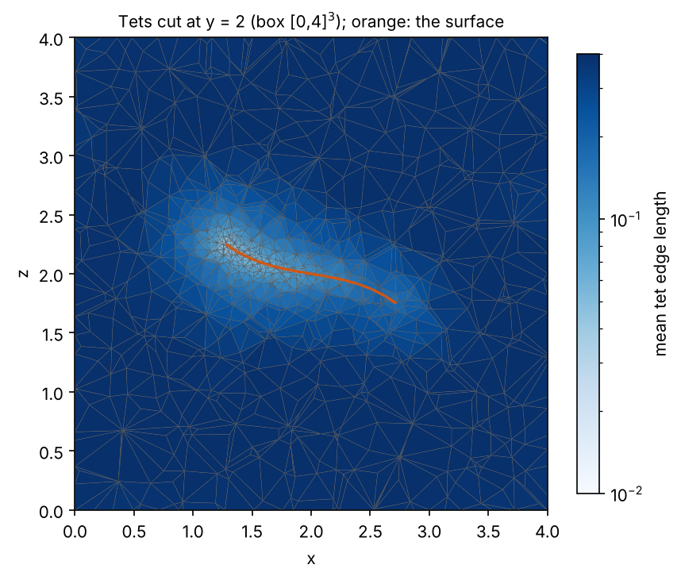
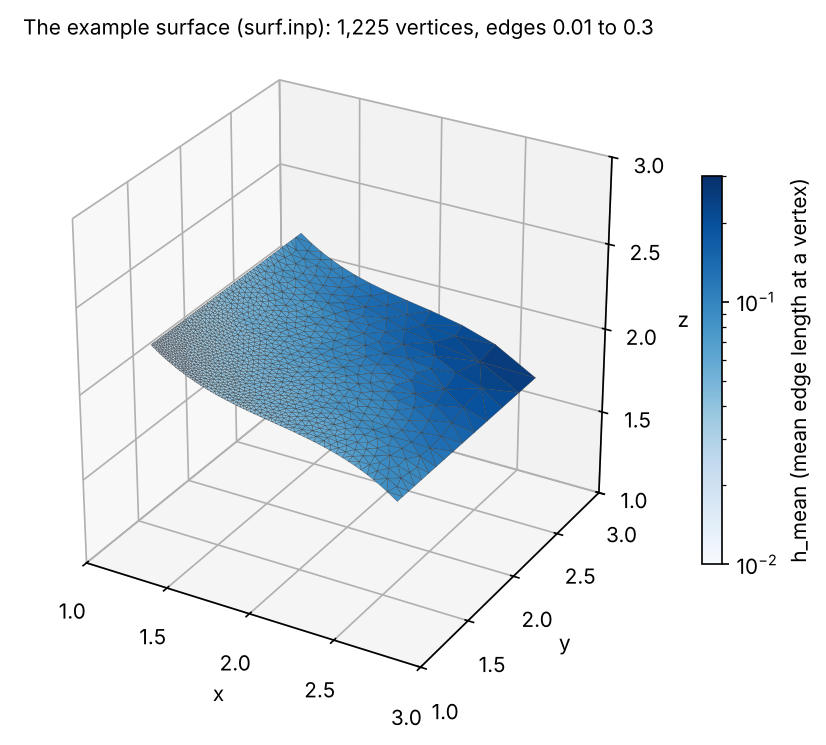
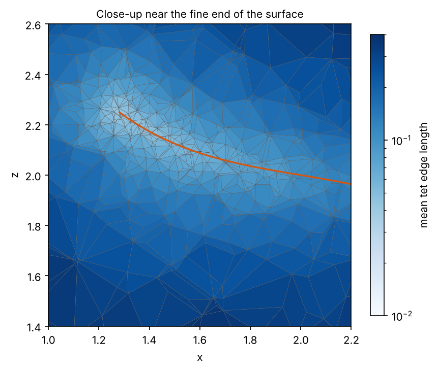
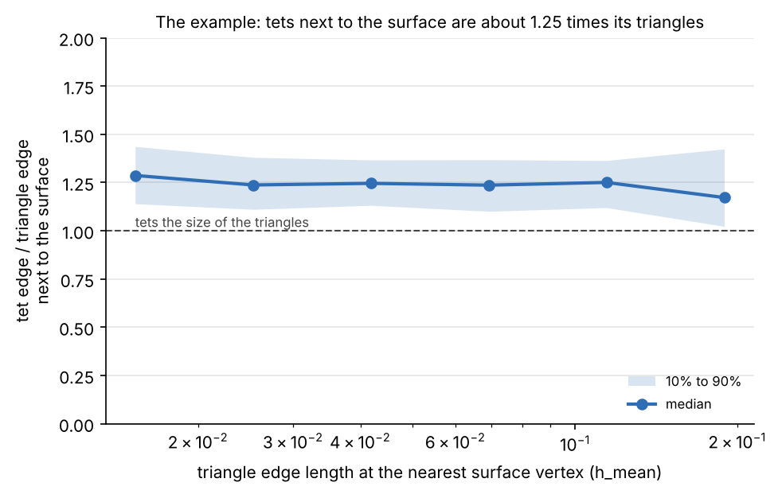
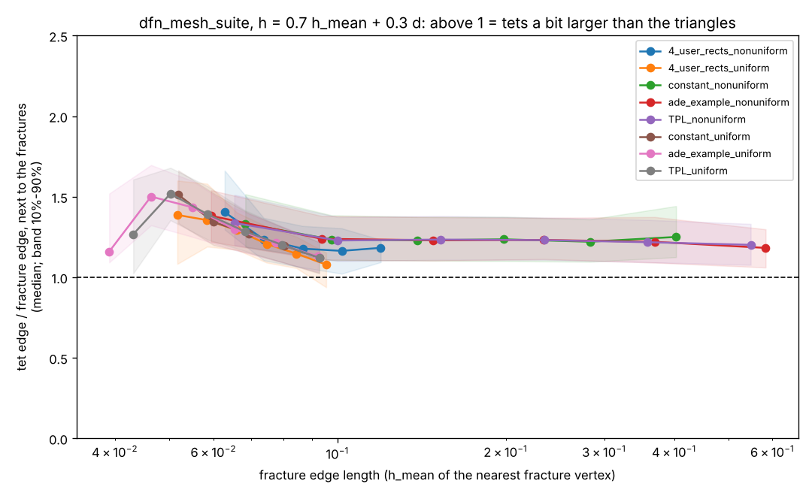

<ul class="uk-breadcrumb">
    <li><a href="{{ "/pages/tutorial/index.html" | relative_url }}">Tutorials &amp; Examples</a></li>
    <li><span>Tet Mesh Graded by a Surface's Edge Lengths</span></li>
</ul>

# Tet Mesh Graded by a Surface's Edge Lengths

This tutorial builds a tetrahedral mesh of a box whose tet size is set by
a triangulated surface inside it: next to the surface the tets are about
1.25 times the length of the surface's own triangle edges, and they grow
smoothly away from it. The surface can be a fracture network from
[dfnWorks](https://lanl.github.io/dfnWorks/intro.html) (a DFN or DFM
`full_mesh.inp`), a fault, or any triangulated surface. Its mesh may be
nonuniform (fine at fracture intersections, coarse elsewhere); the tets
follow it with no extra input.

The tets come out a little larger than the triangles on purpose: a later
step can then remove the tets next to the surface and put the triangles
into the tet mesh, which works best when the tets there are not smaller
than the triangles. That step is not part of this tutorial.

It needs LaGriT V3.340 or later (master after November 6, 2026): the
`edge_lengths_mean` attribute and the octree h lookup of
`createpts / poisson_disk / 3d_box` are new in that version.



*The tets of this tutorial, cut at y = 2 and colored by tet edge length;
orange is the surface.*

## The files

Run these in one folder, in this order (about 10 seconds in all):

| File | What it does |
| --- | --- |
| [square.poly](square.poly) | the outline of the example surface, a 1.5 x 1.5 square |
| [surf_h.mlgi](surf_h.mlgi) | the triangle size of the example surface |
| [surf.lgi](surf.lgi) | makes the example surface, `surf.inp` |
| [h_surface.mlgi](h_surface.mlgi) | the tet size, from the surface (the same for every case) |
| [tets.lgi](tets.lgi) | makes the tets, `tet.inp` |

```
lagrit < surf.lgi
lagrit < tets.lgi
```

For your own surface, skip the first three files: put the surface in the
run folder (for dfnWorks, `full_mesh.inp`) and read it in `tets.lgi`
instead of `surf.inp`.

## Step 1. The surface and its edge lengths

`surf.lgi` makes a test surface: a 1.5 x 1.5 sheet, bent and tilted, in
the middle of the box [0,4]<sup>3</sup>. Its triangle edges grow from
0.01 at one corner to 0.3 at the opposite corner, a range of 30 times,
to show that the tets follow the triangles at every size.

The line that matters for the tets is

```
cmo / addatt / mo_surf / edge_lengths_mean / h_mean
```

It puts into each surface vertex the mean length of the edges connected
to a vertex: the local triangle size. (`edge_lengths_min` and
`edge_lengths_max` give the shortest and longest edge; see
[cmo / addatt](../../docs/commands/cmo/cmo_addatt.md).) `tets.lgi` runs
this line again on the surface it reads, so any triangulated surface will
do.



## Step 2. The tet size from the surface

The tet size h is set at every point (x,y,z) of the box by

    h(x,y,z) = min( H_MAX, max( H_MIN,
                    H_FACTOR * H_STAT(nearest surface vertex)
                  + H_GRADE * d(x,y,z) ) )

with d(x,y,z) the distance to the surface. The five names in capitals are
set by `define` in the main deck (Step 3), so the same h file serves every
case:

| Name | Value here | Meaning |
| --- | --- | --- |
| `H_STAT` | `h_mean` | the surface vertex attribute that gives the triangle size (Step 1) |
| `H_FACTOR` | 0.7 | h next to the surface, as a fraction of the triangle size |
| `H_GRADE` | 0.3 | how fast h grows with the distance from the surface |
| `H_MIN` | 0.009 | the smallest h allowed |
| `H_MAX` | 0.3 | the largest h allowed, far from the surface |

So here h = 0.7 h_mean + 0.3 d, kept between 0.009 and 0.3. The first
term makes the tets next to the surface follow its triangles; the second
makes them grow by about 0.3 times the distance traveled, so that
neighboring tets differ by a factor of at most about 1.3.

Why 0.7: Poisson-disk sampling places vertices at least h apart, and its
tet edges are about 1.4 h to 1.8 h long, so 0.7 times the triangle edge
gives tets about 1.25 times the triangle edge. The mean edge length is
used rather than the shortest edge because it is steadier along fracture
intersections, where short edges would otherwise pull h down.

[h_surface.mlgi](h_surface.mlgi) computes h. `createpts / poisson_disk`
runs this file on the vertices of its internal mesh object
`mo_poi_h_field`, and takes h from their attribute `h_field_att`. Line by
line, with h for `h_field_att` and d for the temporary attribute `d_s`:

```
interpolate / voronoi / mo_poi_h_field h_field_att / 1,0,0 / &
      mo_surf H_STAT / keepatt
```

h = H_STAT of the nearest surface vertex (`h_mean` of `mo_surf`). With
`keepatt`, the nearest-vertex lookup is kept (the attribute `pt_gtg`) for
the next line.

```
compute / distance_field / mo_poi_h_field / mo_surf / d_s
```

d = the distance to the nearest surface vertex, using the lookup of the
line above instead of searching again (`pt_gtg` is then removed). Next to
the surface, this is within about half a triangle edge of the distance to
the surface itself.

```
math / multiply / mo_poi_h_field / h_field_att / 1,0,0 / &
      mo_poi_h_field / h_field_att / H_FACTOR
```

h = H_FACTOR * h

```
math / multiply / mo_poi_h_field / d_s / 1,0,0 / &
      mo_poi_h_field / d_s / H_GRADE
```

d = H_GRADE * d

```
math / add / mo_poi_h_field / h_field_att / 1,0,0 / &
      mo_poi_h_field / h_field_att / mo_poi_h_field / d_s
cmo / DELATT / mo_poi_h_field / d_s
```

h = h + d, that is, h = H_FACTOR * H_STAT + H_GRADE * distance. Then d is
deleted.

```
math / floor / mo_poi_h_field / h_field_att / 1,0,0 / &
      mo_poi_h_field / h_field_att / H_MIN
math / ceiling / mo_poi_h_field / h_field_att / 1,0,0 / &
      mo_poi_h_field / h_field_att / H_MAX
finish
```

h = max(h, H_MIN), then h = min(h, H_MAX): `floor` sets a lower limit and
`ceiling` an upper limit (see [math](../../docs/commands/MATH.md)).

## Step 3. The tets

The main part of [tets.lgi](tets.lgi):

```
read / avs / surf.inp / mo_surf
cmo / addatt / mo_surf / edge_lengths_mean / h_mean
#
# the box the tets fill
define / POI_XMIN / 0.
define / POI_YMIN / 0.
define / POI_ZMIN / 0.
define / POI_XMAX / 4.
define / POI_YMAX / 4.
define / POI_ZMAX / 4.
define / IF_POI_EDGE_BUFFER / 0
define / POI_EDGE_BUFFER / 1.0
#
# h = H_FACTOR * H_STAT(nearest surface vertex) + H_GRADE * distance
define / H_STAT / h_mean
define / H_FACTOR / 0.7
define / H_GRADE / 0.3
define / H_MIN / 0.009
define / H_MAX / 0.3
#
# the 0.009 here = H_MIN
createpts / poisson_disk / 3d_box / mo_tet / 0.009 / connect / &
      h_surface.mlgi / h_lookup octree / poisson_seed 7
```

- The surface must be read as `mo_surf`, the name `h_surface.mlgi` uses.
- `POI_*` is the box. `IF_POI_EDGE_BUFFER 0` lets h grow right up to the
  box faces.
- `H_STAT`, `H_FACTOR`, `H_GRADE`, `H_MIN` and `H_MAX` are the names used
  by `h_surface.mlgi` (Step 2). Only `H_MIN` and `H_MAX` depend on the
  case; keep `H_FACTOR 0.7` and `H_GRADE 0.3`.
- The 4th argument of `createpts` is the smallest spacing; set it equal
  to `H_MIN`.
- `h_lookup octree` stores h only as finely as it varies, so time and
  memory follow the number of vertices, not the size of the box. On a
  graded fracture case it took 112 s and 0.21 GB, against 1,152 s and
  1.99 GB with the uniform lattice (`hex_grid`). With a control file the
  octree is the default; it is written here to make it explicit.
- `poisson_seed` picks the random realization. The same seed gives the
  same mesh on the same machine (Linux and macOS differ).

See [createpts / poisson_disk](../../docs/commands/createpts/createpts_poisson.md)
for every option.



*Close-up of the cut near the fine end of the surface.*

## Step 4. Check the result

The rest of `tets.lgi` puts four vertex attributes on the tets, then
writes `tet.inp`:

```
cmo / addatt / mo_tet / edge_lengths_mean / tet_edge
cmo / addatt / mo_tet / surf_h / VDOUBLE / scalar / nnodes
interpolate / voronoi / mo_tet surf_h / 1,0,0 / &
      mo_surf h_mean / keepatt
cmo / addatt / mo_tet / ratio / VDOUBLE / scalar / nnodes
math / divide / mo_tet / ratio / 1,0,0 / &
      mo_tet / tet_edge / mo_tet / surf_h
compute / distance_field / mo_tet / mo_surf / dist_surf
```

`ratio` is the tet edge over the triangle edge of the nearest surface
vertex. At tet vertices next to the surface (`dist_surf` less than half
of `surf_h`) it should be between about 1.1 and 1.4. In ParaView, open
`tet.inp` and `surf.inp`, clip the tets with a plane (tick *Crinkle clip*)
and color by `ratio` with the range 0 to 2.

The example generates 7,297 vertices and 43,221 tets. At the 665 vertices next
to the surface, the tet edges are 1.25 times the triangle edges (median;
10% to 90%: 1.11 to 1.38), and fewer than 1% are smaller than the
triangles. The ratio is the same over the whole 30-times range of triangle
sizes:



## Setting the numbers for your case

| Number | Rule |
| --- | --- |
| `POI_*` | the box the tets fill; for dfnWorks, its `domain_size` centered at the origin |
| `H_MIN` | a floor below the finest tets wanted, about a quarter of the finest triangle edge; also the createpts spacing argument |
| `H_MAX` | the coarsest tets, far from the surface, for example a tenth of the box size |
| `H_MAX / H_MIN` | under 100: LaGriT warns when h exceeds 100 times the createpts spacing |

`H_MIN` should not bind: check that
`cmo / printatt / mo_surf / h_mean / minmax` gives a minimum above
`H_MIN / 0.7`.

To change the result:

| To get | Change | Effect (on the example surfaces) |
| --- | --- | --- |
| tets closer to the triangle size | `H_FACTOR / 0.6` | median 1.08; 15 to 19% of the tets smaller than the triangles |
| larger tets next to the surface | `H_FACTOR / 0.8` | median 1.40; none smaller; 13 to 22% fewer vertices |
| slower growth away from the surface | `H_GRADE / 0.2` | more tets between surfaces |
| another realization | `poisson_seed` | same statistics, different vertices |

## Results on dfnWorks meshes

The same deck, with the box and `H_MIN`, `H_MAX` set for each case, was
run on eight dfnWorks fracture meshes (4_user_rects, constant,
ade_example and TPL, each with a uniform and a nonuniform fracture mesh;
from 557 to 244,213 fracture vertices). Next to the fractures the tet
edges were 1.20 to 1.24 times the triangle edges (median) in every case,
at every triangle size, and at most 2% were smaller than the triangles.
The largest case gave 748,450 vertices and 4.7 million tets in 15 minutes
on one core; time grows with the number of tet vertices, about 1 to
1.2 ms each.



*LaGriT master 810fc494 on eight dfnWorks meshes, Linux, one core,
November 2026. Each line is one case; the band is 10% to 90%.*

## See also

[examples/dfn_tets](https://github.com/lanl/LaGriT/tree/master/examples/dfn_tets)
holds Python scripts that run the same kind of mesh for a dfnWorks DFN
from its `full_mesh.inp` and `metadata.json`, estimate its size and time
first, and write a results page. They aim for tets the size of the
triangles (ratio about 1.0); this tutorial aims for tets a little larger
(ratio about 1.25), for the step that puts the triangles into the tets.

## Limits

- The surface is not in the tet mesh: the tets fill the box and are sized
  for the surface. Putting the triangles into the tet mesh is a later step.
- The distance used for h is the distance to the nearest surface vertex,
  not to the triangles. Next to the surface the difference is less than
  about half a triangle edge.
